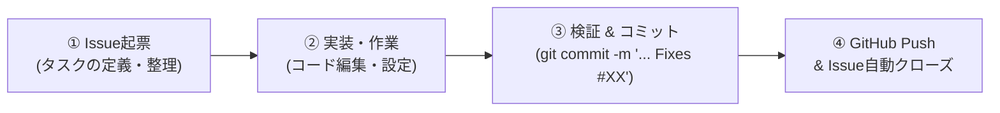

# GitHub Issues 連携・運用ワークフロー

本プロジェクト（`okayamaCafe`）では、すべての開発・改修・コンテンツ更新タスクを **GitHub Issues と常時連携** して進めます。

---

## 1. 運用ルール（Issue駆動ワークフロー）



### ステップ 1: 新規タスク発生時のIssue起票
新しい要望、機能追加、デザイン修正、不具合対応が発生した場合は、まずGitHub Issuesに起票します。
- CLIから作成:
  ```bash
  gh issue create --title "[Feature] ○○機能の実装" --body "..."
  ```
- または GitHub Web画面の「New Issue」からテンプレートを選択して作成。

### ステップ 2: コミットとIssueの紐付け
Gitでコミットを作成する際、メッセージ末尾にIssue番号を含めます：
```bash
git commit -m "feat: ○○機能を実装 Fixes #XX"
```
> **ヒント**: `Fixes #XX` や `Closes #XX` を含めると、GitHubへプッシュした際にそのIssueが自動的にクローズされます。

### ステップ 3: 完了報告とIssueのクローズ
タスクが完了したら、作業成果や検証結果をIssueにコメントし、クローズします。
```bash
gh issue close XX --comment "実装および検証が完了しました。"
```

---

## 2. GitHub CLI (`gh`) の初期セットアップ

ターミナルやコマンドプロンプトからワンコマンドでIssueを操作・同期できるよう、GitHub CLIの認証を完了させます。

```cmd
# ブラウザ認証でログイン（1回のみ実行）
gh auth login -w -h github.com
```

ログイン後、以下のスクリプトを実行することで、これまでの開発履歴（Phase 1〜7）を一括でIssueに同期できます：

```powershell
powershell -ExecutionPolicy Bypass -File scripts\sync-issues.ps1
```
